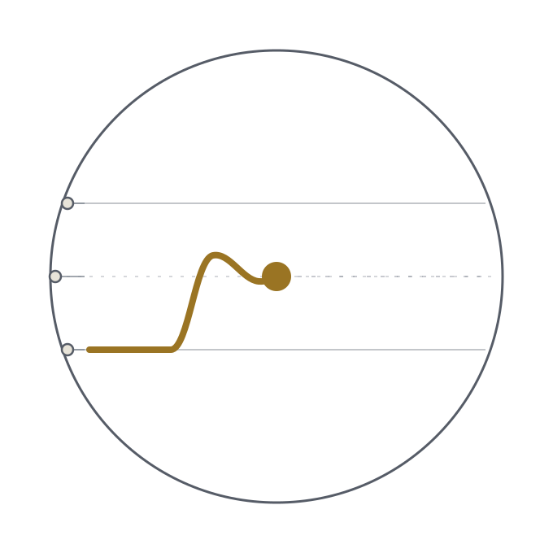

<!--
SPDX-FileCopyrightText: 2026 The IndustryBench contributors

SPDX-License-Identifier: CC-BY-SA-4.0
-->

# IndustryBench

**Drive SCPI instruments from one window, watch every channel live, and keep the readings.**

[](LICENSE)


<table>
<tr>
<td width="300">
  <picture>
    <source media="(prefers-color-scheme: dark)" srcset="img/industrybench-logo-dark.svg" />
    
  </picture>
</td>
<td>

Opens the instruments on a lab bench, plots every channel as it is read, and
writes each run to a file. One window, no modes.

A complete recorder on its own — no network, no certificate, no account. It can
also deliver readings to
[IndustryFlow](https://github.com/IIchukissII/industryflow) over mutual TLS,
which is optional and stays off until configured.

</td>
</tr>
</table>

---

## Install

```bash
git clone https://github.com/IIchukissII/IndustryBench
cd IndustryBench
pip install -r requirements.txt
python -m industrybench
```

Python 3.11+. The first launch seeds three simulated devices, so the console
comes up with live traces on a machine with no instruments attached.

Everything is written under one workspace root — `$INDUSTRYBENCH_HOME` if set,
otherwise the working directory, so `cd` into an experiment folder and run puts
that run's data there. `config/industrybench.db` is the record of truth (SQLite,
WAL); `config/*.json` mirror it readably; `data/runs/`, `data/outbox.db` and
`data/logs/` hold output, the delivery queue and rotating logs. Both directories
are untracked runtime state.

---

## Console

| Pane | Purpose |
|---|---|
| **Channels** (left) | Devices and channels with live values. The tick box controls *plotting only* — the channel is measured either way. |
| **Plots** (middle) | One card per visible channel. Wheel zooms, drag pans, right-click for pyqtgraph's view menu. |
| **Inspector** (right) | Settings for the current selection. Edits apply when a field loses focus. |

**Run bar** — Start/Stop · **every N s**, the assembly cadence (0.1–3600 s,
re-read every beat so a change applies mid-run) · **Save to file** unticked is
preview: traces only, nothing written · counters for scans recorded and beats
with nothing to record · **Clear** drops the traces, leaving files and queued
readings alone.

**Session…** opens three pages, each with an explicit Apply: **Equipment** (what
is under test, which devices take part), **Output file**, **Platform**.

**First measurement:** *+ Device* (kind, address) → *Check the link* (`*IDN?`
off the GUI thread) → *+ Channel* (what it measures, a column, a unit) →
**Start**. A run in progress picks up edits.

---

## How a run works

```
device ──► reader ──► assembler ──► journal ──► file sink        (local)
             │
             └──────────────► outbox (SQLite) ──► IndustryFlow   (optional)
```

One reader thread per device, each at its own rate, so a 90 ms thermocouple does
not hold a 12 ms DC channel to its pace. The assembler takes the latest value of
every channel on each beat as one **scan** and hands it to the journal, which
buffers 10 000 scans for the traces and copies each to the sink.

Start mints a `sensor_id` for any channel lacking one, opens every enabled device
and claims the output file; if no device opens, or the file cannot be claimed,
the run does not start. A read that fails does not remove its column — it arrives
as a non-finite value, a violet `—` on screen and `quality_code = 2` upstream.

---

## Configuration

The console writes all of it. Every field is declared once in
`config/schema.py`, checked on load, and filled from there when omitted. Unknown
keys are preserved, so a driver may read fields specific to its hardware.

A file that fails the check is **never overwritten or discarded**: one bad device
is dropped for that session and named in the log with the offending field and
value, and the rest keep running. SQLite is the record of truth; editing the JSON
by hand only takes effect if the matching table is empty.

```json
{
  "devices": [{
    "name": "Bench multimeter", "kind": "scpi_visa", "enabled": true,
    "address": "USB0::0xVVVV::0xPPPP::SERIAL::INSTR", "timeout_ms": 5000,
    "channels": [{
      "measures": "DC Voltage", "query": "MEAS:VOLT:DC?", "range": "AUTO",
      "column": "supply_v", "unit": "V", "enabled": true
    }]
  }]
}
```

`name` keys the store and must be unique. `column` is the file header and display
name, free to rename; `sensor_id` is minted once and **must not be edited**.

| `kind` | Driver | Needs |
|---|---|---|
| `scpi_visa` | SCPI over VISA | `pyvisa`, `pyvisa-py`, `pyusb` |
| `onewire_probe` | 1-Wire probe | `w1thermsensor`, Linux |
| `sim_probe` · `sim_voltmeter` · `sim_ammeter` | simulated | — |

| `measures` contains | Read as |
|---|---|
| `volt` | `query`, preceded by `:VOLT:DC:RANG` / `:VOLT:DC:RES` |
| `curr` | `query`, preceded by `:CURR:DC:RANG` / `:CURR:DC:RES` |
| `temp` | see [Temperature](#temperature) |
| anything else | `query`, sent as written |

`range: "AUTO"` routes to `:RANG:AUTO ON` rather than being sent as a value,
which would be a syntax error the instrument answers by ignoring.

**`bench.json`** holds `output` (`type` `delimited` or `jsonl`, `enabled`,
`auto_flush`, `settings`), `run` (`interval`, `window`), `console` (`theme`) and
`station`. `{timestamp}` in a path becomes `YYYY-MM-DD_HHMMSS` at run start; a
relative path resolves against the workspace root. **`setups.json`** holds saved
arrangements, `chosen` naming the active one. **Projects** live in the database.

---

## Output files

**delimited** fixes its columns from the first scan, sorted, and keeps every
later line in that shape. A channel absent from a scan leaves its cell empty
rather than shifting the rest; one appearing *after* the header is written is
named in the log and left out of that file.

```csv
taken_at,ambient_c,supply_a,supply_v
2026-08-17T17:36:34.812441,17.96,0.0000004,-0.034
```

**jsonl** has no grid to fix, so a channel added mid-run appears from that point
on, and a run killed mid-write leaves one truncated last line while every
complete line before it still parses.

There is deliberately no local time-series database — SQLite holds only the
configuration and the delivery queue.

---

## Temperature

Two routes, chosen by whether the channel has a `configure` block.

**Read by the instrument.** Sends `*CLS`, `CONF:TEMP …`, `:TRIG:SOUR IMM`, then
`READ?`. The trigger source matters: an instrument left in manual trigger from
front-panel use answers `READ?` only when somebody presses a button.
`timeout_ms` defaults to 30 000 here because `READ?` blocks until the
measurement completes.

```json
{ "measures": "temperature", "query": "READ?",
  "configure": { "probe_type": "TC", "sensor_type": "K", "resolution": "DEF" },
  "column": "probe_c", "unit": "°C", "timeout_ms": 30000 }
```

| `probe_type` | Valid `sensor_type` | Default |
|---|---|---|
| `FRTD`, `RTD` | `85`, `89`, `91`, `92` | `85` |
| `FTHermistor`, `THERmistor` | `2252`, `3000`, `5000`, `10000`, `30000` | `5000` |
| `TC` | `B`, `E`, `J`, `K`, `N`, `R`, `S`, `T` | `B` |
| `ANY` | none — the subtype is omitted | — |

A pairing the instrument would misread is refused before anything reaches the
wire: `85` is a legal RTD alpha and a meaningless thermocouple letter, and an
instrument handed the wrong pairing does not object — it configures something
else and answers with a plausible number.

**Converted here.** Omit `configure` and the raw EMF is converted with the NIST
ITS-90 inverse polynomials (Monograph 175, Table B) and cold-junction
compensation, using `junction` (`K`, `J`, `T`, `E`), `terminals_c` (`25.0`) and
`query` (`MEAS:VOLT:DC?`). Compensation is linear, good to about ±0.3 °C over
0–100 °C, and beyond a type's tabulated span the result is pinned to the nearest
end rather than extrapolated. Terminal temperature is an assumption, not a
measurement, which is why the instrument-side route is more accurate when the
hardware supports it.

```python
emf_to_celsius(0.001053, "T", 21.5)   # -> 46.866
temperature_command("TC", "T")        # -> 'CONF:TEMP TC,T,1,DEF'
```

---

## Delivering to a platform

Entirely optional. Skip it and the bench is a standalone recorder — it still
queues readings it never sends, so turning delivery on later ships the backlog.

The target is [IndustryFlow](https://github.com/IIchukissII/industryflow), where
ingestion is **mutual TLS only** — no token, no API key, no password
([ADR-0002](https://github.com/IIchukissII/industryflow/blob/main/ADR/ADR-0002-ingestion-authentication-and-device-identity.md)).
Transport is `ssl` + `urllib` from the standard library, so an offline bench
pulls in no HTTP dependency. Fill in **Session… → Platform**: bench name, site,
ingest URL, and PEM paths for the client certificate, key and CA. The key never
leaves the machine — only the path is stored.

| Identity | What it is | Where it lives | In the payload? |
|---|---|---|---|
| `company_id` | the tenant | the client certificate | **no** — ADR-0002 forbids it |
| `station_id` | this bench, as a gateway | `bench.json` → `station` | no — the certificate carries it |
| `equipment_id` | the thing under test | the project | yes |
| `sensor_id` | one channel | the channel | yes |

`equipment_id` belongs to the project, not the device — one meter serves
different equipment in different projects, and a run with no project records
locally and forwards nothing. `sensor_id` is stored, never derived, so renaming a
device or a column cannot orphan that channel's history.

One record per channel per reading, matching `SensorDataInput`:

```json
{ "timestamp": "2026-08-16T10:30:00Z", "sensor_id": "2e9bf157-…",
  "equipment_id": "ef9791ba-…", "site_id": "lab_north",
  "value": 2.4981, "unit": "V", "quality_code": 0 }
```

`quality_code` is `0` good, `1` uncertain, `2` bad — read, but not to be trusted.
A bad read is delivered as `2` rather than dropped, sent as `NaN` or flattened to
zero, so the series stays dense and each consumer decides.

The outbox sends 100 readings per request, backs off from 2 s to 300 s, keeps
acknowledged rows and trims past 50 000, and guarantees **at-least-once**. Rows
survive a successful send, so the queue doubles as a local record. The endpoint
may see a reading twice — after a send whose response was lost — which
IndustryFlow absorbs with idempotent writes (ADR-0006); a dropped reading is
recoverable nowhere.

---

## Layout

```
industrybench/
├── app.py · paths.py · logging_setup.py    startup, workspace root, logging
├── config/         schema · defaults · json_store · store · sanitize
├── instruments/    base (the Device contract) · visa · onewire · simulated ·
│                   thermocouple · scpi/temperature
├── acquisition/    runner · readers · scan · journal · project
├── sinks/          base · csv · json — local files only
├── edge/           identity · envelope · outbox (mutual TLS)
└── ui/             window · theme · console/ · session/ · widgets/ · workers/

fonts/   IBM Plex Sans and Mono, bundled (OFL-1.1)
img/     the mark, the logo, and the control glyphs
```

**Type.** IBM Plex ships with the application rather than being hoped for: a
stack whose first choice is absent is a lottery run on whatever the machine has.
Four faces, 768 KB, registered before the first widget exists; if the directory
is missing the stack falls through to system faces and the application still
starts. Figures use `tnum` and `zero`, set on the font itself since Qt style
sheets have no `font-feature-settings`.

---

## Extending

A device subclasses `instruments.base.Device` with `open`, `close`, `is_open`
and `read_channel`, returning `self.reading(channel, value)` — which applies the
shared naming rule, so the column and unit are the same whichever driver produced
them. Return `None` or raise to signal a failed read; the base class turns either
into a placeholder that keeps the column. Register in `DeviceKind`
(`config/schema.py`), `DRIVERS` (`acquisition/runner.py`) and `DEVICE_KINDS`
(`ui/console/inspector.py`).

A sink implements `open`/`write`/`close` on `sinks.base.Sink`. Iterate a scan as
`for column, cell in scan`, or use `scan.cell(name)`, `scan.columns`,
`scan.taken_at`, `scan.as_json()`. Register in `OutputKind`, `WRITERS` and
`OUTPUT_KINDS`.

---

## Troubleshooting

| Symptom | Cause and fix |
|---|---|
| Nothing answers at that address | **Check the link** reports the specific failure. List what the machine sees: `python -c "import pyvisa; print(pyvisa.ResourceManager().list_resources())"` |
| `pyvisa is not installed` | `pip install pyvisa pyvisa-py pyusb`. `pyusb` is the USB backend — without it a USB instrument is invisible even though `pyvisa` imports fine. |
| Start does nothing | No enabled device opened, or the output file could not be claimed. The log says which. |
| `READ?` times out | The instrument is in manual or single trigger. Set the front panel to Auto, or raise `timeout_ms`. |
| Temperature reads plausibly but wrongly | The probe family does not match what is wired. The pairing is validated, the wiring is not. |
| A channel shows `—` in violet | A non-finite read. The log has what the device actually replied. |
| A device vanished from the tree | Its entry failed the schema check. The log names the field and value; the file is untouched, so correcting it restores the device. |
| Queued but never delivered | **Session… → Platform** lists what is missing. If the link is ready, check a project is chosen — without one there is no `equipment_id`. |

Nothing written at all usually means *Save to file* is unticked. Logs are
`data/logs/industrybench_YYYYMMDD.log`; the terminal shows warnings and above.

---

## Dependencies

`PyQt6`, `pydantic` ≥ 2, `pyqtgraph` and `numpy` are required. `pyvisa`,
`pyvisa-py` and `pyusb` are needed for real SCPI hardware; `w1thermsensor` for
DS18B20 probes on Linux. The config store, outbox and delivery use `sqlite3`,
`ssl` and `urllib` from the standard library. Missing optional backends are
reported at startup and disable only their own device kinds.

---

## License

AGPL-3.0-or-later. Documentation and the logo are CC-BY-SA-4.0; the bundled
IBM Plex faces are OFL-1.1. See `LICENSES/` and `REUSE.toml`.

**Related** — [IndustryFlow](https://github.com/IIchukissII/industryflow), the
platform this bench can deliver to.
